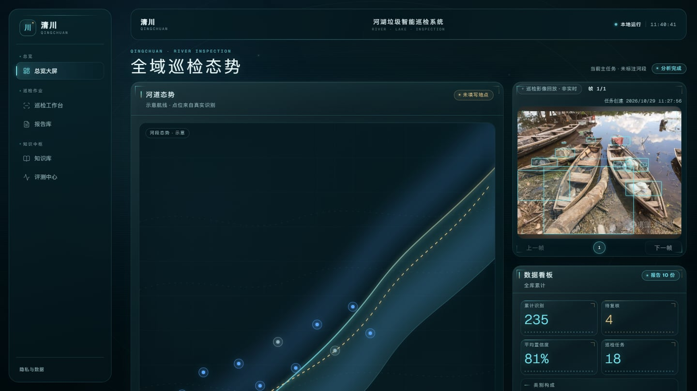
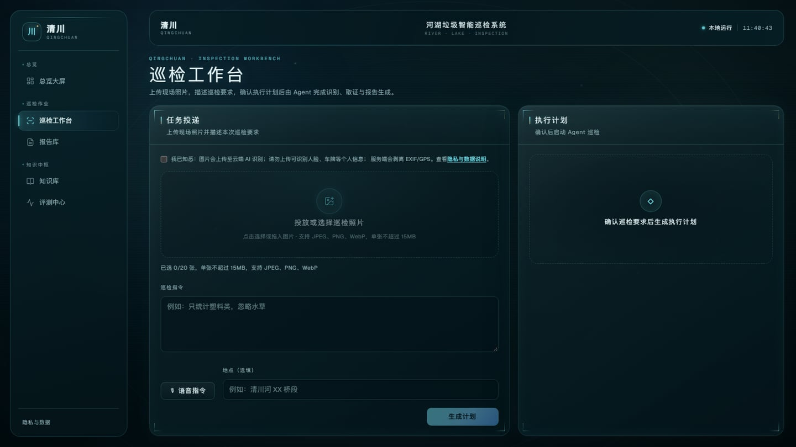
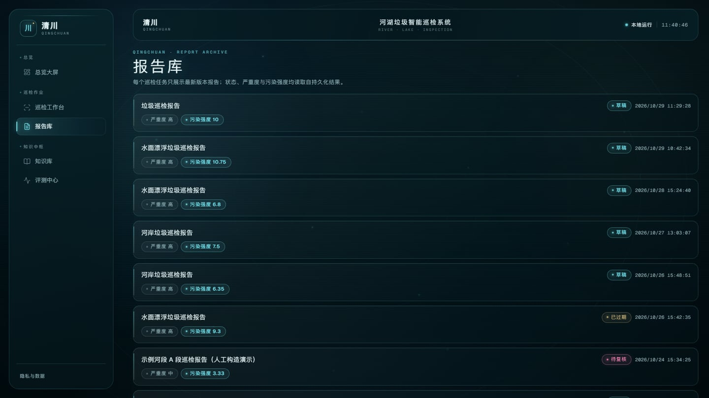
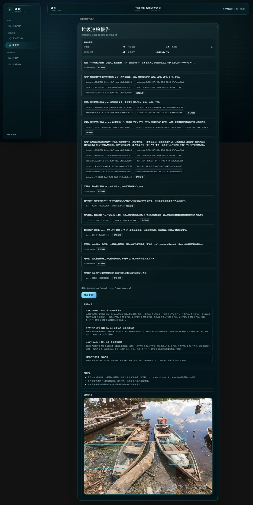
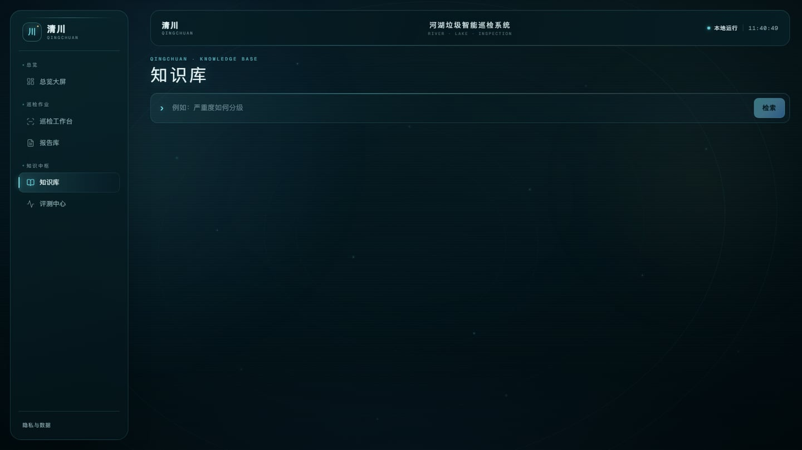
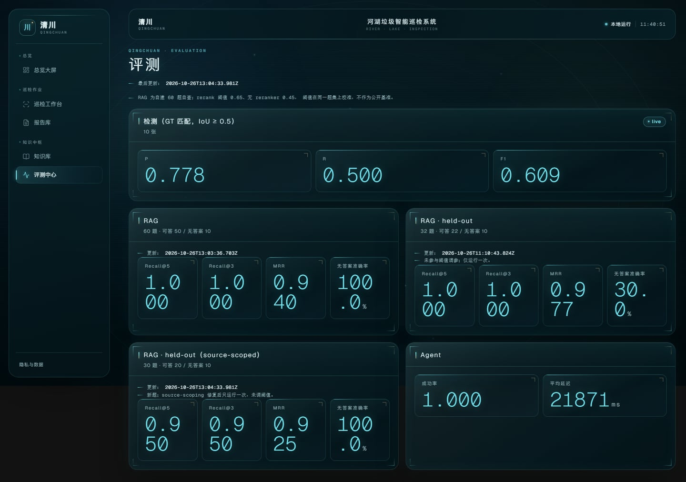
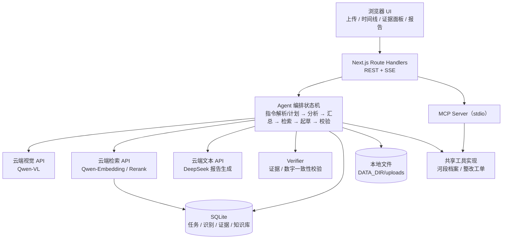

# 清川河湖垃圾智能巡检系统 V1.0

清川是一个 AI Native 的河湖垃圾巡检 Web 应用。巡查人员上传手机或无人机照片、用一句话说明任务，Agent 自动完成识别分类、计数与严重度评估、标准条款溯源、巡检报告生成、人工复核与 PDF 导出。

每条结论都可以追溯到原图识别框和对应的标准条款，目标是让基层河长、河道保洁员和环保志愿者"拍照即巡检"。

## 核心价值

1. **拍照即巡检，门槛低。** 不需要专业设备或本地 GPU：手机/无人机照片 + 一句话指令即可产出结构化巡检结果，普通浏览器就能使用。
2. **结论可追溯，敢用于整改。** 报告中的每条结论都绑定原图识别框、置信度与标准条款；低置信目标自动进入人工复核队列，Verifier 校验证据与数字一致性。
3. **从识别到报告闭环。** 识别、严重度计算、标准检索、报告生成、复核纠错、PDF 导出和 MCP 工单集成在同一条流程里，减少重复整理材料的时间。
4. **计划可确认，关注不丢证据。** Planner 把一句话解析为关注类别与五步执行计划，用户确认后才开始分析；关注类别只是视觉提示，其他类别仍会识别、统计并进入复核。规划阶段 Planner 可通过 Function Calling 调用 `search_standards` 检查知识库依据，调用轨迹随计划展示并持久化；指令明确要求时，还会选择河段档案或整改工单工具，由 orchestrator 实际调用并写入时间线与审计（当前工具为 mock，界面标注示意）；工单只在报告完成且无待复核项时创建，否则标记为待人工复核。

## 为什么是“前端 + AI 交互”作品

清川不是“后端跑模型、前端贴结果”的演示页。**前端是 AI 工作流的产品本体**：

- 一句话指令 → Planner 解析/Function Calling 检索 → 五步计划确认 → 步骤级 SSE 时间线 → 证据画布 ↔ 结论 ↔ 条款三向联动 → 低置信复核 → 报告导出。
- AI 输出被转成可操作的前端状态：计划可确认、工具调用可观察、识别框可点选、结论可追溯、低置信项可复核、未通过 Verifier 时导出被拦截。
- 全息大屏、报告库、知识库、评测页共用同一套前端设计系统；后端只是 Next.js Route Handlers 的 AI/数据接入层，负责模型调用、检索、证据校验与持久化，不抢产品主叙事。
- 评委在浏览器里能直接感到“AI 在工作流里”，而不是在聊天框里等一段文字。

## 功能截图

### 总览大屏



### 巡检工作台



### 报告库与报告详情





### 知识库与评测中心





## 技术架构



- 编排采用确定性状态机 + LLM 解析/决策点（关注类别、可选工具），每一步写入 `agent_steps`，记录耗时、费用与错误，可审计、可复现。
- 严重度、证据匹配等关键计算是纯 TypeScript 代码，模型不直接决定最终数字。
- 所有推理调用云端 API；本地只需要 Node.js 和 SQLite 文件，不需要 GPU、Docker 或 WSL。
- 图片与数据库落在本地 `DATA_DIR`，由应用直接读取；知识库向量在进程内做余弦相似度检索，无需向量数据库。

## 目录结构

```text
qingchuan/
├─ src/app/            Next.js 页面与 API Route Handlers（含 SSE）
├─ src/components/     UI 组件：上传、时间线、证据面板、复核、报告、布局
├─ src/lib/agent/      Agent 编排状态机、SSE、报告生成、工具层
├─ src/lib/vision/     云端 VLM 接入与结果校验
├─ src/lib/rag/        切片、向量化、检索、rerank、知识库入库
├─ src/lib/domain/     领域模型、证据链、严重度公式
├─ src/lib/db/         Drizzle schema、SQLite 客户端与查询封装
├─ src/mcp/            MCP Server（复用应用工具层）
├─ scripts/            知识库入库、演示种子、评测、MCP 启动
├─ deploy/             PM2 / Nginx 配置与部署说明
├─ data/               SQLite、上传图片（运行时）；knowledge/ 知识库源文件（版本化）
├─ public/samples/     演示样例图（需自行补齐，见目录内 README）
├─ tests/              单元测试、E2E 与评测夹具
└─ docs/               设计与交付文档
```

## 本地运行

要求：Node.js >= 20（推荐 20 LTS）、npm，以及可访问云端 API 的网络。

```bash
# 1. 安装依赖
npm install

# 2. 配置环境变量
cp .env.example .env.local
# 在 .env.local 中填入 DEEPSEEK_API_KEY 与 DASHSCOPE_API_KEY

# 3. 初始化 SQLite 表结构
npm run db:push

# 4. 知识库入库（调用 DashScope Embedding）
#    tsx 脚本不会自动读取 .env.local，先导出环境变量：
set -a; . ./.env.local; set +a
npm run ingest

# 5. 启动开发服务器
npm run dev
```

打开 <http://localhost:3000>。

可选：写入演示数据（需先准备 `public/samples/sample-1.jpg` … `sample-3.jpg`）：

```bash
set -a; . ./.env.local; set +a
npm run seed
```

演示数据说明：`npm run seed` 写入的识别结果与报告是**人工构造的示例数据**（报告内 `source: manual`，页面显示"人工构造示例"徽标），用于演示复核与导出流程；它不是实时 AI 模型输出，也不是评测证据。仓库在 `public/samples/` 提供 NOAA 公有领域样例照片；真实评测结果由脚本写入 `data/eval/results.json`，并在 `/eval` 页面展示。

Windows PowerShell 可使用 `$env:DATA_DIR="./data"` 等形式逐个设置变量；`.env.local` 不会被 Next.js 之外的 `tsx` 脚本自动加载。

## 常用命令

| 命令 | 说明 |
| --- | --- |
| `npm run dev` | 启动开发服务器 |
| `npm run build` | 生产构建 |
| `npm run start` | 启动生产服务器（需先 build） |
| `npm run lint` | ESLint 检查 |
| `npm run typecheck` | TypeScript 严格类型检查 |
| `npm test` | 运行 Vitest 单元测试 |
| `npm run test:e2e` | 运行 Playwright E2E（自动启动 dev server） |
| `npm run db:push` | 将 schema 同步到 SQLite |
| `npm run db:generate` | 生成 Drizzle 迁移文件 |
| `npm run ingest` | 将 `data/knowledge/*.md` 入库并生成向量 |
| `npm run seed` | 写入演示任务、识别与报告（需样例图） |
| `npm run eval:detection` | 检测评测（GT 匹配 P/R/F1，`-- --dry-run` 仅验证管线） |
| `npm run eval:rag` | RAG 校准集评测（Recall@5 / Recall@3 / MRR / 无答案准确率） |
| `npm run eval:rag:heldout` | RAG held-out 评测（修复前基线，阈值固定） |
| `npm run eval:rag:scoped` | RAG source-scoped held-out 评测（新题，只跑一次） |
| `npm run eval:agent` | Agent 场景评测（真实依赖，无 dry-run） |
| `npm run mcp` | 以 stdio 启动 MCP Server（等价于 `npx tsx scripts/run-mcp.ts`） |

密钥只放在 `.env.local`（本地）或 `.env`（服务器），不得提交到 Git。

## 部署

生产环境使用 Linux + Node.js 20 + PM2 + Nginx + SQLite，无 GPU、无 Docker。概要：

1. `npm ci`、复制 `.env.example` 为 `.env` 并填入密钥，设置 `DATA_DIR=/opt/qingchuan/data`；
2. `npm run db:push`、`npm run ingest`、`npm run build`；
3. `pm2 start deploy/ecosystem.config.cjs` 并 `pm2 save`；
4. 用 `deploy/nginx.conf.example` 配置反向代理（20MB 请求体、SSE 关闭缓冲、`X-Forwarded-For` 覆盖为真实客户端地址），再用 certbot 启用 HTTPS；
5. 每日备份 SQLite 与上传目录。

完整步骤、备份脚本与 MCP 配置见 [deploy/README.md](deploy/README.md)。

### 知识库语料（2026-10-26）

知识库从 6 条种子 SOP 扩到 **61 条**：

- `清川SOP` 6 条（项目自编现场作业规范）。
- `CJJ/T 174-2013` 23 条（城市水域保洁作业及质量标准，摘编）。
- `DB31/T 1639-2025` 18 条（河湖维修养护技术要求，摘编）。
- `GB/T 19095-2019` 14 条（生活垃圾分类标志，摘编）。

来源、版本与链接记录在 `data/knowledge/sources.json`；外部标准均为公开条款/章节摘编，逐条注明来源，**非逐字全文**。能核实为官方条款号的标注为“第 X 条/表”，其余使用 `摘编-标准-章节-主题` 稳定标识，避免冒充官方条款号。`DB4401/T 4-2018` 因已于 2024-07-01 废止，未纳入语料。

## 评测方法

评测以**可复现、可核对**为原则，脚本位于 `scripts/eval-*.ts`，结果只由脚本写入 `data/eval/results.json`，并在 `/eval` 页面展示。

- **检测**：对每张带人工 GT 的图片，在 IoU ≥ 0.5 下做类别匹配，统计 TP/FP/FN，计算 Precision、Recall、F1；无法定位的预测计为 FP。`--dry-run` 只用夹具里的模拟预测验证匹配管线，**不是效果证据**，不得用于对外宣称模型指标。
- **RAG**：对固定问题集检索前 5 条条款，分别统计 Recall@5、Recall@3、MRR；另用无答案题统计拒答准确率。各指标分母分开，不把拒答题混进召回率。
- **Agent**：在真实视觉/检索/生成依赖下跑正常、低置信、无知识依据、提示注入四类场景，统计最终状态成功率与平均耗时。

`data/eval/results.json` 只能由真实评测运行生成，禁止手工编写或补数字。当前文件包含多段真实云端运行（RAG 2026-10-26；Agent/检测 2026-10-24）：

- **RAG（校准集）**：**60 题**（50 道可答 + 10 道无答案）；Recall@5 **1.00**、Recall@3 **1.00**、MRR **0.94**、无答案准确率 **1.00**。带 reranker 的评测阈值 `0.65`、无 reranker 的 MCP/回退路径阈值 `0.45`，均在同一题集上校准，属于自建小样本自查，不构成公开基准。
- **RAG（held-out，修复前）**：**32 题**（22 道可答 + 10 道近义干扰/无答案）；Recall@5 **1.00**、Recall@3 **1.00**、MRR **0.977**、无答案准确率 **0.30**。这暴露了跨标准来源约束缺失，作为历史负向结果保留。
- **RAG（held-out，source-scoped，新题）**：**30 题**（20 道可答 + 10 道近义干扰/无答案），修复后**只运行一次、未调阈值**；Recall@5 **0.95**、Recall@3 **0.95**、MRR **0.925**、无答案准确率 **1.00**。唯一可答 miss 是“清川SOP 规定严重度如何分级？”被 scoped 后 rerank 判为无依据；保留为下一轮新 held-out 的改进线索，不回头调这批题。
- RAG 两段更新于 2026-10-26；Agent/检测段仍为 2026-10-24。
- **Agent**：成功率 **4/4（100%）**，平均耗时约 21.9 秒（单次真实运行，2026-10-24）。场景使用不同样例图：`normal` / `no-evidence` 用 `sample-2.jpg`（无低置信目标），`low-confidence` 用 `sample-1.jpg`（含 <0.5 目标），`injection` 在读取图片前即被拒绝。模型输出具有随机性，换一次运行的具体结果可能不同；复核 → 重新生成 → 导出的闭环另有单元测试与 E2E 覆盖。
- **检测**：10 张 NOAA 公有领域单目标裁片，人工标注 GT，真实 VLM 运行：Precision **0.78**、Recall **0.50**、F1 **0.61**（IoU ≥ 0.5，类别感知）。这是小样本自查，不是大规模基准；GT 为人工粗框，结果不宜与公开数据集的 mAP/F1 直接比较。

评测夹具与诚实性规则详见 [tests/eval/README.md](tests/eval/README.md)。

## 隐私说明

完整说明见站内 `/privacy` 页面（源码在 `src/app/privacy/page.tsx`）。

- 上传前必须勾选隐私与数据使用确认；上传文件仅接受 JPEG/PNG/WebP，单张不超过 15MB。
- **服务端会用 sharp 重新编码图片，自动旋转并剥离 EXIF/GPS/XMP 元数据**，最长边限制在 2000px；保存的是处理后图片。
- 上传照片与本地 SQLite 数据库都保存在部署机器上（`DATA_DIR`），不会长期上传到第三方对象存储。
- **只有在执行分析任务时，处理后的图片才会发送到云端视觉 API**（DashScope Qwen-VL）；文本指令、检索查询与报告上下文会发送到 DashScope / DeepSeek。第三方服务可能按其自身政策保留请求数据。
- 请勿拍摄可识别人脸、车牌、身份证件等个人信息；如无法避免，请先打码或裁剪再上传。
- API Key 只保存在服务器的 `.env` 中，权限 600，不进入 Git；演示样例图需登记来源与许可证。
- 删除 `DATA_DIR/uploads` 与对应 SQLite 记录即可移除本地数据；第三方云端请求需按服务商控制台处理。

## 提交状态（2026-10-29）

- 本地分支见 `git branch --show-current`；未配置 remote、未推送、未建 tag（最新提交见 `git log -1`）。
- 质量门：lint 0 error（1 个既有 `` 警告）、typecheck、build 通过；**56 文件 / 409 单测**、Playwright **7/7** 全绿。
- 局域网（非安全上下文）上传已修复：`createClientId()` 在 `crypto.randomUUID` 不可用时回退 `getRandomValues`，单测与 Chromium 实测通过。
- 任务解析：DeepSeek Planner + Function Calling 检索工具 + 关键词回退；规划阶段可真实调用 `search_standards` 并展示/持久化调用轨迹；五步计划可确认；关注类别为软提示，检索使用“关注类别 ∪ 实际检出类别”。
- 可选工具：Planner 按指令选择 `get_river_profile` / `create_work_order`，orchestrator 真实执行并写入 `agent_steps` 与时间线；MCP Server 复用同一工具实现。
- 规划期 Function Calling + MCP：Planner 通过 in-memory MCP 客户端调用 MCP `search_standards`（协议真实走通，失败回退本地检索）；trace 记录 `via` / `scope`，写入 `planningTrace` / `planJson` 并在计划面板展示。
- source-scoped retrieval：问题点名 `CJJ/T 174-2013`、`DB31/T 1639-2025`、`GB/T 19095-2019` 或 `清川SOP` 时，检索只在该标准内进行；旧 held-out 的近义拒答 0.30 → 新 scoped held-out 1.00。
- 真实评测：RAG 校准集 **60 题** Recall@5 **1.00** / Recall@3 **1.00** / MRR **0.94** / 无答案 **1.00**；held-out（修复前）**32 题** Recall@5 **1.00** / MRR **0.977** / 无答案 **0.30**；source-scoped held-out（新题）**30 题** Recall@5 **0.95** / Recall@3 **0.95** / MRR **0.925** / 无答案 **1.00**；Agent **4/4**（单次运行）；检测 **P 0.78 / R 0.50 / F1 0.61**（10 张 NOAA 单目标裁片，人工 GT）。
- 完整技术文档见 docs，运行与部署步骤见下方。
- 详见 [提交检查清单](docs/submission-checklist.md)。

## 团队

| 成员 | 学校 | 联系方式 |
| --- | --- | --- |
| 熊斯琦 | 上海海洋大学 | 2953208955@qq.com |

## 文档

- [设计文档](docs/superpowers/specs/2026-10-22-qingchuan-design.md)
- [实施计划](docs/superpowers/plans/2026-10-22-qingchuan.md)
- [部署指南](deploy/README.md)
- [提交检查清单](docs/submission-checklist.md)
- [评测说明](tests/eval/README.md)

## License

本项目以 [MIT License](LICENSE) 发布。
