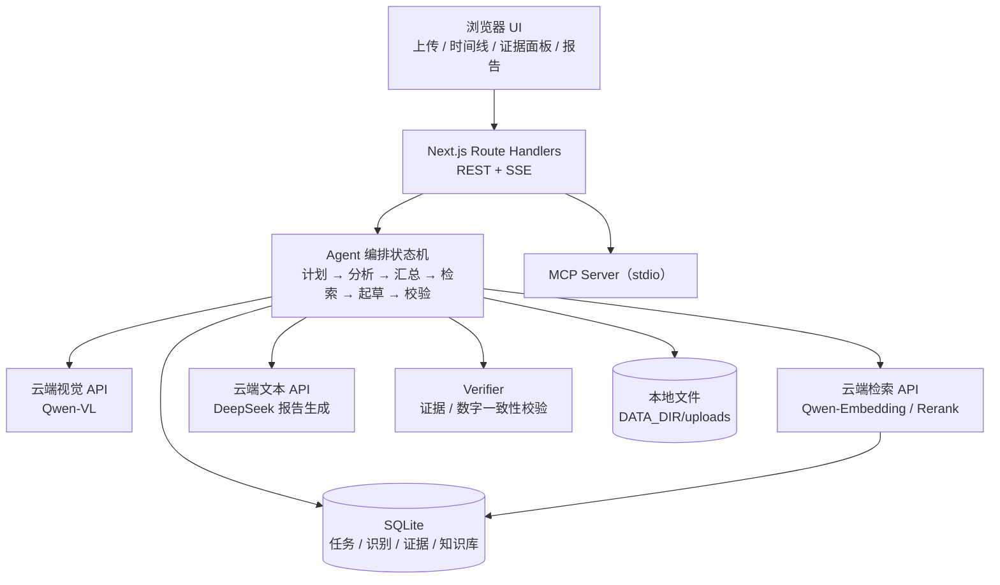

# 清川 · 河湖垃圾多模态巡检 Agent

清川是一个 AI Native 的河湖垃圾巡检 Web 应用。巡查人员上传手机或无人机照片、用一句话说明任务，Agent 自动完成识别分类、计数与严重度评估、标准条款溯源、巡检报告生成、人工复核与 PDF 导出。

每条结论都可以追溯到原图识别框和对应的标准条款，目标是让基层河长、河道保洁员和环保志愿者"拍照即巡检"。

## 核心价值

1. **拍照即巡检，门槛低。** 不需要专业设备或本地 GPU：手机/无人机照片 + 一句话指令即可产出结构化巡检结果，普通浏览器就能使用。
2. **结论可追溯，敢用于整改。** 报告中的每条结论都绑定原图识别框、置信度与标准条款；低置信目标自动进入人工复核队列，Verifier 校验证据与数字一致性。
3. **从识别到报告闭环。** 识别、严重度计算、标准检索、报告生成、复核纠错、PDF 导出和 MCP 工单集成在同一条流程里，减少重复整理材料的时间。

## 功能截图

> 待补充：巡检时间线、证据面板、复核队列、报告页与评测页截图。

## 技术架构



- 编排采用确定性状态机 + LLM 决策点，每一步写入 `agent_steps`，记录耗时、费用与错误，可审计、可复现。
- 严重度、证据匹配等关键计算是纯 TypeScript 代码，模型不直接决定最终数字。
- 所有推理调用云端 API；本地只需要 Node.js 和 SQLite 文件，不需要 GPU、Docker 或 WSL。
- 图片与数据库落在本地 `DATA_DIR`，由应用直接读取；知识库向量在进程内做余弦相似度检索，无需向量数据库。

## 目录结构

```text
qingchuan/
├─ src/app/            Next.js 页面与 API Route Handlers（含 SSE）
├─ src/components/     UI 组件：上传、时间线、证据面板、复核、报告、布局
├─ src/lib/agent/      Agent 编排状态机、SSE、报告生成、工具层
├─ src/lib/vision/     云端 VLM 接入与结果校验
├─ src/lib/rag/        切片、向量化、检索、rerank、知识库入库
├─ src/lib/domain/     领域模型、证据链、严重度公式
├─ src/lib/db/         Drizzle schema、SQLite 客户端与查询封装
├─ src/mcp/            MCP Server（复用应用工具层）
├─ scripts/            知识库入库、演示种子、评测、MCP 启动
├─ deploy/             PM2 / Nginx 配置与部署说明
├─ data/               SQLite、上传图片、知识库源文件（运行时生成）
├─ public/samples/     演示样例图（需自行补齐，见目录内 README）
├─ tests/              单元测试、E2E 与评测夹具
└─ docs/               设计与交付文档
```

## 本地运行

要求：Node.js >= 20（推荐 20 LTS）、npm，以及可访问云端 API 的网络。

```bash
# 1. 安装依赖
npm install

# 2. 配置环境变量
cp .env.example .env.local
# 在 .env.local 中填入 DEEPSEEK_API_KEY 与 DASHSCOPE_API_KEY

# 3. 初始化 SQLite 表结构
npm run db:push

# 4. 知识库入库（调用 DashScope Embedding）
#    tsx 脚本不会自动读取 .env.local，先导出环境变量：
set -a; . ./.env.local; set +a
npm run ingest

# 5. 启动开发服务器
npm run dev
```

打开 <http://localhost:3000>。

可选：写入演示数据（需先准备 `public/samples/sample-1.jpg` … `sample-3.jpg`）：

```bash
set -a; . ./.env.local; set +a
npm run seed
```

Windows PowerShell 可使用 `$env:DATA_DIR="./data"` 等形式逐个设置变量；`.env.local` 不会被 Next.js 之外的 `tsx` 脚本自动加载。

## 常用命令

| 命令 | 说明 |
| --- | --- |
| `npm run dev` | 启动开发服务器 |
| `npm run build` | 生产构建 |
| `npm run start` | 启动生产服务器（需先 build） |
| `npm run lint` | ESLint 检查 |
| `npm run typecheck` | TypeScript 严格类型检查 |
| `npm test` | 运行 Vitest 单元测试 |
| `npm run test:e2e` | 运行 Playwright E2E（自动启动 dev server） |
| `npm run db:push` | 将 schema 同步到 SQLite |
| `npm run db:generate` | 生成 Drizzle 迁移文件 |
| `npm run ingest` | 将 `data/knowledge/*.md` 入库并生成向量 |
| `npm run seed` | 写入演示任务、识别与报告（需样例图） |
| `npm run eval:detection` | 检测评测（GT 匹配 P/R/F1，`-- --dry-run` 仅验证管线） |
| `npm run eval:rag` | RAG 检索评测（Recall@5） |
| `npm run eval:agent` | Agent 场景评测（真实依赖，无 dry-run） |
| `npm run mcp` | 以 stdio 启动 MCP Server（等价于 `npx tsx scripts/run-mcp.ts`） |

密钥只放在 `.env.local`（本地）或 `.env`（服务器），不得提交到 Git。

## 部署

生产环境使用 Linux + Node.js 20 + PM2 + Nginx + SQLite，无 GPU、无 Docker。概要：

1. `npm ci`、复制 `.env.example` 为 `.env` 并填入密钥，设置 `DATA_DIR=/opt/qingchuan/data`；
2. `npm run db:push`、`npm run ingest`、`npm run build`；
3. `pm2 start deploy/ecosystem.config.cjs` 并 `pm2 save`；
4. 用 `deploy/nginx.conf.example` 配置反向代理（20MB 请求体、SSE 关闭缓冲、`X-Forwarded-For` 覆盖为真实客户端地址），再用 certbot 启用 HTTPS；
5. 每日备份 SQLite 与上传目录。

完整步骤、备份脚本与 MCP 配置见 [deploy/README.md](deploy/README.md)。

## 评测方法

评测以**可复现、可核对**为原则，脚本位于 `scripts/eval-*.ts`，结果只由脚本写入 `data/eval/results.json`，并在 `/eval` 页面展示。

- **检测**：对每张带人工 GT 的图片，在 IoU ≥ 0.5 下做类别匹配，统计 TP/FP/FN，计算 Precision、Recall、F1；无法定位的预测计为 FP。`--dry-run` 只用夹具里的模拟预测验证匹配管线，**不是效果证据**，不得用于对外宣称模型指标。
- **RAG**：对固定问题集检索前 5 条条款，统计命中期望条款的 Recall@5。
- **Agent**：在真实视觉/检索/生成依赖下跑正常、低置信、无知识依据、提示注入四类场景，统计最终状态成功率与平均耗时。

`data/eval/results.json` 只能由真实评测运行生成，禁止手工编写或补数字。**当前仓库未包含该文件：评测脚本已就绪，正式结果待准备真实标注/密钥并运行后生成。** 在结果生成前，本 README 不宣称任何评测数字。

评测夹具与诚实性规则详见 [tests/eval/README.md](tests/eval/README.md)。

## 隐私说明

- 上传照片与本地 SQLite 数据库都保存在部署机器上（`DATA_DIR`），不会长期上传到第三方存储。
- **只有在执行分析任务时，图片才会被发送到云端视觉 API**（DashScope Qwen-VL）；文本指令与检索内容会发送到对应的云端文本/Embedding API。
- 请勿拍摄可识别人脸、车牌等个人信息；如不可避免，请先打码。应用会原样保存上传的图片字节，**不会自动剥离 EXIF/GPS**，请在**上传前自行移除**。
- API Key 只保存在服务器的 `.env` 中，权限 600，不进入 Git；演示样例图需登记来源与许可证。

## 团队

| 角色 | 成员 | 分工 |
| --- | --- | --- |
| 待补充 | 待补充 | 待补充 |

## 文档

- [设计文档](docs/superpowers/specs/2026-10-22-qingchuan-design.md)
- [实施计划](docs/superpowers/plans/2026-10-22-qingchuan.md)
- [部署指南](deploy/README.md)
- [提交检查清单](docs/submission-checklist.md)
- [评测说明](tests/eval/README.md)

## License

本项目以 [MIT License](https://opensource.org/licenses/MIT) 发布。
